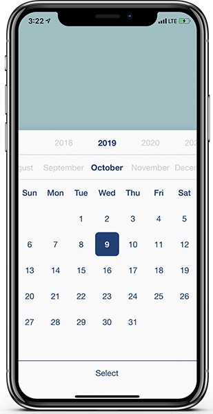
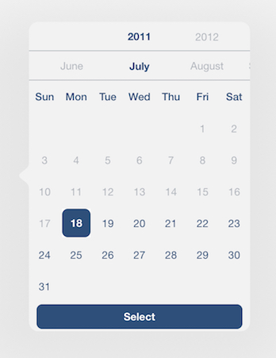
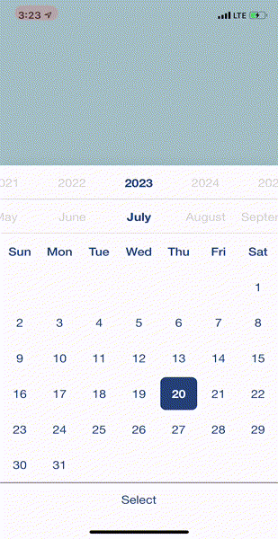
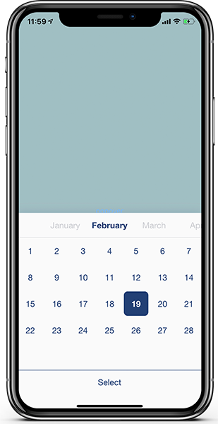

# DatePicker

[](https://cocoapods.org/pods/DatePicker)
[](https://cocoapods.org/pods/DatePicker)
[](https://cocoapods.org/pods/DatePicker)
### A DatePicker for iOS 15 and Above
- iPhone and iPad support (bottom sheet, centered card, or popover)
- Presentation styles: `.automatic`, `.sheet`, `.popover`, `.center`
- Light and dark mode, with fully customizable colors
- Customizable confirm-button title and font
- Locale-aware calendar grid (respects the user's first day of the week)
- Swift Package Manager and CocoaPods
- Easy to use

|||  |
|:---:|:---:|:---:|
| iPhone | iPad | In Action |

## Installation

### CocoaPods

DatePicker is available through [CocoaPods](https://cocoapods.org). Add the
following line to your Podfile:

```ruby
pod 'DatePicker', '~> 2.0'
```

### Swift Package Manager

In Xcode, go to **File → Add Package Dependencies…** and enter the repository URL:

```
https://github.com/AmirShayegh/DatePicker.git
```

Or add it to your `Package.swift`:

```swift
dependencies: [
    .package(url: "https://github.com/AmirShayegh/DatePicker.git", from: "2.0.0")
]
```

## Quick Usage

```swift
import DatePicker

class ViewController: UIViewController {

    @IBAction func dateButton(_ sender: UIButton) {
        let minDate = DatePickerHelper.shared.dateFrom(day: 18, month: 8, year: 1990)!
        let maxDate = DatePickerHelper.shared.dateFrom(day: 18, month: 8, year: 2030)!

        // Create the picker
        let datePicker = DatePicker()

        // Configure it
        datePicker.setup(beginWith: Date(), min: minDate, max: maxDate) { selected, date in
            if selected, let date = date {
                print(date.formatted(date: .long, time: .omitted))
            } else {
                print("Cancelled")
            }
        }

        // Present it (a sheet on iPhone, a popover from `sender` on iPad)
        datePicker.show(in: self, on: sender)
    }
}
```

## Detailed Usage

### 1) Import the library

```swift
import UIKit
import DatePicker
```

### 2) Configure

There are three ways to configure a `DatePicker`. Each takes a completion
closure that reports whether the user confirmed a selection.

**Basic** — pick any date within 2018…2100 (or the selected year, whichever
is wider):

```swift
let datePicker = DatePicker()
datePicker.setup(beginWith: Date()) { selected, date in
    if selected, let date = date {
        print(date.formatted(date: .long, time: .omitted))
    } else {
        print("Cancelled")
    }
}
```

`beginWith` is optional; omit it to start on today.

**Minimum / maximum** — constrain selection to a date range:

```swift
let minDate = DatePickerHelper.shared.dateFrom(day: 18, month: 8, year: 1990)!
let maxDate = DatePickerHelper.shared.dateFrom(day: 18, month: 8, year: 2030)!

datePicker.setup(beginWith: Date(), min: minDate, max: maxDate) { selected, date in
    if selected, let date = date {
        print(date.formatted(date: .long, time: .omitted))
    } else {
        print("Cancelled")
    }
}
```

**Yearless** — select a day and month independent of any year. The closure
returns `month` and `day` as integers:

```swift
let datePicker = DatePicker()
datePicker.setupYearless { selected, month, day in
    if selected, let month = month, let day = day {
        // DatePickerHelper.shared.month(number:) gives the localized month name
        print("Selected \(DatePickerHelper.shared.month(number: month)) \(day)")
    } else {
        print("Cancelled")
    }
}
```

You can bound a yearless picker with `minMonth` / `minDay` / `maxMonth` /
`maxDay`, e.g. `setupYearless(minMonth: 3, minDay: 8) { ... }`.



### 3) Present

Use `show(in:style:sourceView:)` to choose how the picker appears:

```swift
// Bottom sheet (the default)
datePicker.show(in: self)

// Centered card over a dimmed backdrop
datePicker.show(in: self, style: .center)

// Popover anchored to a view — ideal for iPad
datePicker.show(in: self, style: .popover, sourceView: button)
```

`DatePickerStyle` options:

| Style | Behavior |
|---|---|
| `.automatic` | Popover on iPad when a `sourceView` is given, otherwise a sheet |
| `.sheet` | Bottom sheet sized to the picker |
| `.popover` | Popover anchored to `sourceView` (falls back to a sheet if none) |
| `.center` | Centered card over a dimmed, tap-to-dismiss backdrop |

The convenience `show(in:on:)` picks a popover on iPad (when an anchor view is
provided) and a sheet everywhere else:

```swift
datePicker.show(in: self, on: sender)
```

> The older `display(in:)` and `displayPopOver(on:in:)` methods still exist as
> deprecated aliases for backward compatibility — prefer `show(in:style:)`.

### 4) Customize

**Confirm button** — localize or restyle the "Select" button:

```swift
datePicker.selectButtonTitle = "Confirm"
datePicker.selectButtonFont = .systemFont(ofSize: 18, weight: .semibold)
```

**Colors** — set a single palette used for both light and dark mode:

```swift
datePicker.setColors(main: .systemBlue,
                     background: .systemBackground,
                     inactive: .secondaryLabel)
```

…or provide explicit light and dark colors:

```swift
datePicker.colors(mainLight: .systemBlue,   backgroundLight: .white, inactiveLight: .lightGray,
                  mainDark:  .systemTeal,   backgroundDark:  .black, inactiveDark:  .darkGray)
```

## Credit
- [Designed by Roop Jawl](https://www.linkedin.com/in/roopjawl/)
- [Developed by Amir Shayegh](https://www.linkedin.com/in/shayegh/)


## License

DatePicker is available under the MIT license. See the LICENSE file for more info.
